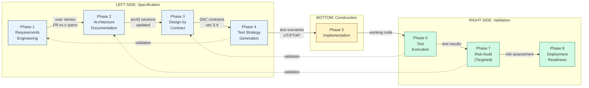

# V-Model Development Workflow

This skill defines the prescribed development process for a project. It orchestrates
the whole skill set into a coherent end-to-end lifecycle: requirements, architecture,
design, implementation, testing, validation, deployment readiness. Every feature, bug
fix, and change follows this workflow, with appropriate phase skipping based on change
size and on the current lifecycle phase.

## Project Context (read first)

Before planning any work, read the project context so this workflow adapts to the
target project instead of assuming a stack:

- `.vmodel.yml` at the project root: machine-readable stack and command hooks (`test-command`, `e2e-test-command`, `security-scan-command`, `build-command`, `deploy-command`), the ID prefixes, the docs path, and the current `lifecycle-phase`.
- `docs/project-context.md`: the human-readable brief and house rules (no em-dashes, Swiss German spelling).

If neither file exists, use the `vmodel-setup` skill, which scaffolds both files from
its bundled templates. If that skill is not installed, ask the user for the stack and the
current lifecycle phase and write the two files by hand. Never hardcode a stack, a
platform, or a test or deploy command. Always resolve them from the context.

## Lifecycle Layer: Inception, Build, Run

The workflow sits under a coarse three-phase lifecycle. The `lifecycle-phase` value in
`.vmodel.yml` tells the workflow where the project is and therefore which V-Model
phases are active and how deep to go. Each skill in the set has its own "Phase
Adaptation" section that shifts its depth to match.

| Lifecycle phase | Goal | Active V-Model phases | Home skills |
|-----------------|------|-----------------------|-------------|
| **Inception** | Frame the problem and design the solution | Phases 1 to 4 (the left side) plus discovery | persona-analysis, requirements-engineering, arc42-documentation, arc42-design-by-contract, test-strategy (planning) |
| **Build** | Construct and validate | Phases 5 to 7 (bottom plus ascending right side), with 2 to 4 kept current per increment | test-strategy (execution), arc42-risk-audit (targeted), arc42-docs-viewer |
| **Run** | Operate and maintain | Phase 8 plus operational passes of 2 and 7 | deployment-readiness, arc42-risk-audit (operational), arc42-documentation (freshness) |

The eight V-Model phases below are the same in every lifecycle phase. What changes is
which phases are required, and the depth described in each skill's Phase Adaptation
section.

## V-Model Phase-to-Skill Mapping



### V-Model Symmetry

The V-Model's power comes from its symmetric validation structure. Each left-side
phase has a corresponding right-side validation phase:

```
Requirements Engineering ...................... Test Execution (Acceptance Tests)
    |                                                ^
    v                                                |
Architecture Documentation .................... Risk Audit (architecture validation)
    |                                                ^
    v                                                |
Design by Contract ............................ Test Execution (Unit/Module Tests)
    |                                                ^
    v                                                |
Test Strategy Generation                             |
    |                                                |
    v                                                |
Implementation ............ Code .....................
```

---

## Phase Definitions

### Phase 1: Requirements Engineering

**Skill**: `requirements-engineering` (optionally seeded by `persona-analysis`)

**Purpose**: Capture, structure, and validate requirements before development begins.

**Entry Criteria**:
- A feature request, project brief, or user story exists (even informal)
- Stakeholder input is available (or the user can provide it)

**Activities**:
1. Analyze the project brief or feature request
2. Identify or validate personas (leverage `persona-analysis` if personas are needed)
3. Elicit user stories with acceptance criteria (US-XX.X format)
4. Write functional requirements (FR-XX.X) and non-functional requirements (NFR-XX.X)
5. Produce a traceability matrix linking stories to requirements
6. If the change touches the user interface: run `interaction-model` (Build) for the
   objects it touches. Output: concept inventory, object map and object-action matrix in
   `docs/ui/`. No layout work before the matrix exists for those objects.

**Exit Criteria / Outputs**:
- User stories with acceptance criteria documented
- Functional and non-functional requirements in FR-XX.X / NFR-XX.X format
- Traceability matrix (stories to requirements)
- Updated requirements companion document in the docs path
- For UI changes: the `interaction-model` artifacts in `docs/ui/`, updated

---

### Phase 2: Architecture Documentation Update

**Skill**: `arc42-documentation` (browsable via `arc42-docs-viewer`)

**Purpose**: Update the arc42 architecture documentation to reflect the new feature or change.

**Entry Criteria**:
- Requirements from Phase 1 are documented
- For existing projects, current arc42 documentation exists in the docs path

**Activities**:
1. Update Section 01 (Introduction and Goals) with new requirements
2. Update Section 05 (Building Block View) if new components are introduced
3. Update Section 06 (Runtime View) if new interaction scenarios are needed
4. Update Section 09 (Architecture Decisions) with any new ADRs
5. Update Section 12 (Glossary) with new domain terms
6. Update other sections as needed based on the change scope

**Exit Criteria / Outputs**:
- Relevant arc42 sections updated
- New ADRs documented for significant decisions
- Glossary current with any new terms

---

### Phase 3: Design by Contract Specification

**Skill**: `arc42-design-by-contract`

**Purpose**: Write formal behavioural contracts for new or modified components.

**Entry Criteria**:
- Architecture documentation updated (Phase 2 complete)
- Component boundaries identified in Section 05

**Activities**:
1. Identify affected logical components (new or modified)
2. Trace invariants from the data model
3. Trace preconditions from route or input validation
4. Trace postconditions from route handlers
5. Map source files to components (Implementation Mapping table)
6. Update system-wide invariants in Section 8.8 if needed
7. Identify any contract violations for Section 11

**Exit Criteria / Outputs**:
- DbC specifications in Section 5.4 for affected components
- Implementation Mapping tables current
- System-wide invariants updated if applicable
- Contract violations documented in Section 11

---

### Phase 4: Test Strategy Generation

**Skill**: `test-strategy`

**Purpose**: Generate structured test scenarios that validate the requirements and contracts.

**Entry Criteria**:
- DbC contracts from Phase 3 exist
- Functional requirements from Phase 1 exist
- User stories with acceptance criteria from Phase 1 exist

**Activities**:
1. Derive unit/module test scenarios from DbC contracts (UT- prefix)
2. Derive functional test scenarios from requirements (FT- prefix)
3. Derive acceptance test scenarios from user stories (AT- prefix)
4. Produce test data specifications
5. Build traceability matrix: test to requirement to contract

**Exit Criteria / Outputs**:
- Test scenarios documented at all three levels (UT, FT, AT)
- Test data specifications defined
- Traceability matrix linking tests to requirements to contracts
- Test strategy document produced

---

### Phase 5: Implementation

**Purpose**: Build the feature using iterative development.

**Entry Criteria**:
- Test strategy from Phase 4 exists (tests define "done")
- Architecture and contracts define "how"

**Activities**:
1. Implement data model changes (if any)
2. Implement API endpoints following the DbC contracts
3. Implement frontend components and pages (if applicable)
4. Follow a contract-first pattern where the stack allows: API spec, generated types, validation schemas, route handlers that satisfy the DbC preconditions and postconditions
5. Iterate with continuous validation against the contracts

**Exit Criteria / Outputs**:
- Feature code complete and functional
- API endpoints match the API specification
- Frontend renders and interacts correctly (if applicable)
- No type or build errors (per `build-command`)

---

### Phase 6: Test Execution

**Hook**: the project's `test-command` and `e2e-test-command` from `.vmodel.yml`

**Purpose**: Execute the test strategy from Phase 4 against the implementation.

**Entry Criteria**:
- Implementation from Phase 5 is complete
- Test scenarios from Phase 4 are defined

**Activities**:
1. Run unit/module tests validating DbC contract compliance (`test-command`)
2. Run functional tests validating requirement satisfaction
3. Run acceptance tests validating user story completion
4. Run end-to-end tests (`e2e-test-command`)
5. Fix any failing tests (iterate back to Phase 5 as needed)

**Exit Criteria / Outputs**:
- All test scenarios from Phase 4 passing
- End-to-end tests passing
- No regressions in existing tests

---

### Phase 7: Risk Audit (Targeted)

**Skill**: `arc42-risk-audit`

**Purpose**: Validate that the new code does not introduce architectural or operational risks.

**Entry Criteria**:
- Tests from Phase 6 are passing
- Implementation is code-complete

**Activities**:
1. Run a targeted risk audit on the categories relevant to the change:
   - New API endpoints: Category 1 (Access Control), Category 7 (Input/Output Contracts)
   - Data model changes: Category 2 (Referential Integrity), Category 3 (Data Consistency)
   - Bulk operations: Category 4 (Behavioural Consistency)
   - Performance-sensitive changes: Category 5 (Performance)
2. Document any new risks in Section 11 (R-00x format)
3. Produce mitigation plans for High-severity findings

**Exit Criteria / Outputs**:
- Targeted audit complete for relevant categories
- No new High-severity risks (or mitigations planned/applied)
- Section 11 updated with any new findings

---

### Phase 8: Deployment Readiness Check

**Skill**: `deployment-readiness`

**Purpose**: Run the structured pre-release go/no-go checklist before publishing.

**Entry Criteria**:
- All previous phases complete
- No unresolved High-severity risks

**Activities**:
1. Run the `deployment-readiness` five-category checklist (security, risk delta, documentation freshness, integration health, smoke test coverage)
2. Verify the Definition of Done checklist for the applicable tier (see below)
3. Produce the go/no-go recommendation
4. Only on GO or GO WITH CONDITIONS, invoke the project's `deploy-command`

**Exit Criteria / Outputs**:
- Deployment readiness report produced with a go/no-go recommendation
- Definition of Done checklist satisfied for the applicable tier
- Deployment baseline updated in Section 11 after a successful release

---

## Definition of Done

The Definition of Done has three tiers calibrated by change size. All items in the
applicable tier must be satisfied before work is considered complete.

### Tier 1: Full Feature / Epic

All items are **mandatory**:

- [ ] User stories documented with acceptance criteria (US-XX.X)
- [ ] Functional and non-functional requirements specified (FR-XX.X, NFR-XX.X)
- [ ] Traceability matrix: stories to requirements to tests
- [ ] Arc42 architecture documentation updated (relevant sections)
- [ ] DbC contracts written for new/modified components (section 5.4)
- [ ] Test strategy generated with UT/FT/AT scenarios
- [ ] All tests passing (unit, functional, acceptance, end-to-end)
- [ ] No new High-severity risks from targeted audit
- [ ] Section 11 updated with any new findings
- [ ] Glossary updated with new terms
- [ ] Code builds without type or build errors (per `build-command`)
- [ ] `deployment-readiness` recommendation is GO or GO WITH CONDITIONS

### Tier 2: Standard Feature / Bug Fix

**Mandatory** items:

- [ ] Root cause identified (bug fix) or user story documented (feature)
- [ ] Arc42 documentation updated if architecture changes
- [ ] DbC contracts updated if component behaviour changes
- [ ] End-to-end tests passing (`e2e-test-command`)
- [ ] No new High-severity risks in affected areas
- [ ] Code builds without type or build errors

**Optional** items (recommended but not blocking):

- [ ] Test strategy document updated
- [ ] Section 11 reviewed for new findings

### Tier 3a: Hotfix / Patch

**Mandatory** items:

- [ ] Fix is targeted and minimal
- [ ] End-to-end tests passing (no regressions)
- [ ] Code builds without type or build errors
- [ ] If touching auth, data models, or validation: targeted risk audit on affected categories

**Optional** items:

- [ ] Arc42 documentation updated
- [ ] DbC contracts reviewed

### Tier 3b: Documentation Only

**Mandatory** items:

- [ ] Documentation changes are accurate and cross-references are valid
- [ ] No code changes included

**Optional** items:

- [ ] Mermaid diagrams validated for syntax

---

## Phase Skip Criteria

Not every change requires all eight phases. Use the matrix below to determine which
phases to execute based on change type. The current `lifecycle-phase` narrows this
further: in Run, Phases 1 to 4 usually only fire for change requests, while Phase 8 is
always in play.

| Phase | Full Feature / Epic | Standard Feature | Bug Fix | Hotfix / Patch | Docs Only |
|-------|:------------------:|:----------------:|:-------:|:--------------:|:---------:|
| 1. Requirements Engineering | Required | Required | Skip | Skip | Skip |
| 2. Architecture Documentation | Required | If arch changes | Skip | Skip | Required |
| 3. Design by Contract | Required | If behaviour changes | Skip | Skip | Skip |
| 4. Test Strategy | Required | If new scenarios | Skip | Skip | Skip |
| 5. Implementation | Required | Required | Required | Required | Skip |
| 6. Test Execution | Required | Required | Required | Required | Skip |
| 7. Risk Audit (Targeted) | Required | If security/data | If security/data | If security/data | Skip |
| 8. Deployment Readiness | Required | Required | Required | Required | Skip |

### Change Type Classification

| Change Type | Description | Example |
|-------------|-------------|---------|
| **Full Feature / Epic** | New capability spanning multiple components, new domain entities, major flows | "Add a reporting module" |
| **Standard Feature** | Single-component enhancement, new API endpoint, new page | "Add filtering by tag" |
| **Bug Fix** | Correcting incorrect behaviour in existing functionality | "Fix total not updating on status change" |
| **Hotfix / Patch** | Urgent production fix, security patch, config change | "Fix injection in the search endpoint" |
| **Docs Only** | Documentation updates with no code changes | "Update Section 07 for new environment variables" |

### Skip Justification

When skipping a phase, document the justification briefly. Examples:

- "Phase 1 skipped: bug fix with clear root cause, no new requirements"
- "Phase 3 skipped: user interface only change, no behavioural contract modification,
  interaction-model matrix updated in docs/ui/"

A user interface change is never a reason to skip the interaction model. If Phase 3 is
skipped for a UI-only change, run `interaction-model` Audit on the changed screens instead,
and add its operational principles and undo rules to Phase 4.
- "Phase 7 skipped: standard feature with no security or data integrity implications"

---

## Workflow Execution Guidelines

### Full Lifecycle (Epic / Major Feature, typically Inception into Build)

Execute all eight phases in sequence. This is the default for any work that
introduces new domain concepts, new entities, or significant architectural changes.

1. **Phase 1**: Elicit requirements. Produce user stories and requirements.
2. **Phase 2**: Update arc42 documentation. Add ADRs for significant decisions.
3. **Phase 3**: Write DbC contracts for new components. Update existing contracts if modified.
4. **Phase 4**: Generate test strategy. Derive scenarios from contracts and requirements.
5. **Phase 5**: Implement the feature iteratively. Use contracts as the behavioural specification.
6. **Phase 6**: Execute all test scenarios via the project hooks. Fix failures.
7. **Phase 7**: Run targeted risk audit on affected categories. Address High-severity findings.
8. **Phase 8**: Run `deployment-readiness` and verify Definition of Done (Tier 1).

### Abbreviated Lifecycle (Standard Feature / Bug Fix, typically Build)

Execute only the phases indicated by the skip matrix. Typical flow for a standard feature:

1. **Phase 1**: Document the user story and acceptance criteria.
2. **Phase 2/3/4**: Update architecture, contracts, and test strategy if the feature changes architecture, component behaviour, or introduces new test scenarios.
3. **Phase 5**: Implement the feature.
4. **Phase 6**: Run the tests.
5. **Phase 7**: If the feature touches auth, data models, or validation: run targeted risk audit.
6. **Phase 8**: Run `deployment-readiness` and verify Definition of Done (Tier 2).

Typical flow for a bug fix:

1. **Phase 5**: Identify root cause and implement fix.
2. **Phase 6**: Run tests to verify fix and no regressions.
3. **Phase 7**: If the fix touches auth, data models, or validation: run targeted risk audit.
4. **Phase 8**: Verify Definition of Done (Tier 2).

### Maintenance / Patch Lifecycle (Hotfix, typically Run)

Minimal flow for urgent fixes:

1. **Phase 5**: Implement the targeted fix.
2. **Phase 6**: Run tests (regression check only).
3. **Phase 7**: If the fix touches auth, data models, or validation: run targeted risk audit on affected categories.
4. **Phase 8**: Verify Definition of Done (Tier 3a).

---

## Skill Reference

| Phase / Role | Skill | Key Outputs |
|--------------|-------|-------------|
| 1. Requirements Engineering | `requirements-engineering` | User stories (US-XX.X), requirements (FR-XX.X, NFR-XX.X), traceability matrix |
| 1a. Persona Analysis (Inception) | `persona-analysis` | Persona roster (P1-Pn), needs tables, gap matrix |
| 2. Architecture Documentation | `arc42-documentation` | Arc42 sections 01-12, companion docs |
| 2a. Docs Viewer (shareable docs) | `arc42-docs-viewer` | Browsable web viewer over the arc42 docs |
| 3. Design by Contract | `arc42-design-by-contract` | DbC contracts (section 5.4), system invariants (section 8.8), violations (section 11) |
| 4. Test Strategy | `test-strategy` | Test scenarios (UT/FT/AT), test data specs, traceability matrix |
| 5. Implementation | (standard development) | Working code, API endpoints, frontend components |
| 6. Test Execution | project hooks (`test-command`, `e2e-test-command`) | Test results, end-to-end verification |
| 7. Risk Audit | `arc42-risk-audit` | Risk entries (R-00x), mitigation plans, Section 11 updates |
| 8. Deployment Readiness | `deployment-readiness` | Go/no-go report, Definition of Done verification |
| 1b. Interaction Model (any UI change) | `interaction-model` (skill library) | Concept inventory, object map, object-action matrix, posture, layers, signifiers in `docs/ui/` |
| Brand (any user interface or document) | `inacta-brand` | Inacta palette, typography, logo for consistent styling |

---

## Artifact Locations

All documentation artifacts produced by this workflow live in the docs path declared
in `.vmodel.yml` (default `docs/arc42/`):

| Artifact | Path (default) | Produced By |
|----------|------|-------------|
| Arc42 sections 01-12 | `docs/arc42/01-*.md` through `docs/arc42/12-*.md` | Phase 2 |
| Requirements companion | `docs/arc42/requirements.md` | Phase 1 |
| Functional decomposition | `docs/arc42/functional-decomposition.md` | Phase 1 |
| Test strategy | `docs/arc42/test-strategy.md` | Phase 4 |
| Deployment readiness report | `docs/deployment-readiness-report.md` | Phase 8 |
| Section index | `docs/arc42/README.md` | Phase 2 |

## Portability

This skill is stack-neutral and vendor-neutral. It orchestrates the other V-Model
skills and resolves everything project-specific, the stack, the command hooks, the ID
prefixes, and the current lifecycle phase, from `.vmodel.yml` and
`docs/project-context.md` (see "Project Context" above). To adopt the workflow in a new
project, run the `vmodel-setup` skill along with installing the skills listed in
the Skill Reference table, fill in the stack and set `lifecycle-phase`. The workflow
then adapts automatically based on the lifecycle phase and the change type.
